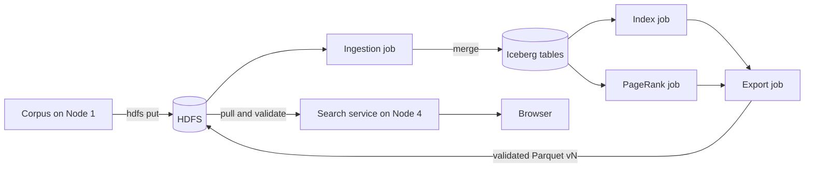

# Distributed Search Engine

A four-node search engine for the Big Data 2026 project <em>Distributed Search Engine</em>. Spark ingests a Simple English Wikipedia corpus into Apache Iceberg tables on HDFS, builds an inverted index and PageRank, and exports a validated Parquet version that a FastAPI service loads into memory and ranks with BM25 and PageRank.

  <a href="#overview">Overview</a> &bull;
  <a href="#architecture">Architecture</a> &bull;
  <a href="#pipeline">Pipeline</a> &bull;
  <a href="#ranking">Ranking</a> &bull;
  <a href="#verified-results">Results</a> &bull;
  <a href="#fault-tolerance">Fault tolerance</a> &bull;
  <a href="#repository-layout">Repository</a> &bull;
  <a href="#getting-started">Getting started</a> &bull;
  <a href="#design-decisions">Decisions</a>

> [!NOTE]
> Every stage is built and tested, and the full pipeline passes on one machine against real HDFS and a real Spark standalone cluster (`bash scripts/local_e2e.sh`). It has not yet been run across four separate machines. [RUNBOOK.md](RUNBOOK.md) has the steps for that.

## Overview

The corpus is about 1,000 Simple English Wikipedia pages. It arrives in two phases: a dirty base file in Phase 0, then a change set of deletes and upserts in Phase 1. Some rows are malformed and some are duplicates, and Phase 1 removes pages that other pages link to.

The system does the following:

- Validates records, rejects bad ones, and removes duplicate document IDs.
- Keeps versioned tables in Iceberg on HDFS, so any earlier state can be read or restored.
- Builds the inverted index and computes PageRank on Spark executors.
- Publishes each new search version only after it passes validation.
- Keeps serving the previous version when a later export fails.

## Architecture

| Node | Runs | Role |
|---|---|---|
| Node 1 | Spark driver, HDFS client | Holds the corpus, uploads it to HDFS, runs ingestion |
| Node 2 | NameNode, DataNode, Spark worker | Stores Iceberg data and metadata |
| Node 3 | Spark master, Spark worker, DataNode, Spark drivers | Runs indexing, PageRank and export |
| Node 4 | FastAPI service, HDFS client | Pulls exports, serves search and the frontend |

The HDFS replication factor is 2, across Nodes 2 and 3. Node 4 runs no Spark or HDFS daemon and never reads Iceberg.

