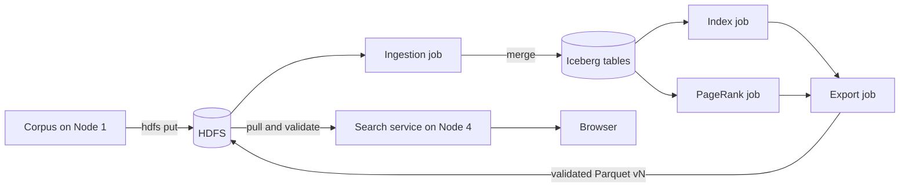

<div align="center">

# Distributed Search Engine

<p>
A four-node search engine for the Big Data 2026 project <em>Distributed Search Engine</em>. Spark ingests a Simple English Wikipedia corpus into Apache Iceberg tables on HDFS, builds an inverted index and PageRank, and exports a validated Parquet version that a FastAPI service loads into memory and ranks with BM25 and PageRank.
</p>


<p>
  <a href="#overview">Overview</a> &bull;
  <a href="#architecture">Architecture</a> &bull;
  <a href="#pipeline">Pipeline</a> &bull;
  <a href="#ranking">Ranking</a> &bull;
  <a href="#verified-results">Results</a> &bull;
  <a href="#fault-tolerance">Fault tolerance</a> &bull;
  <a href="#repository-layout">Repository</a> &bull;
  <a href="#getting-started">Getting started</a> &bull;
  <a href="#design-decisions">Decisions</a>
</p>

</div>

> [!NOTE]
> Every stage is built and tested. The full pipeline passes on one machine (`bash scripts/local_e2e.sh`) and across four containers that stand in for the four nodes (`bash scripts/rehearse_four_nodes.sh`). It has not yet been run on four physical machines over ZeroTier. [RUNBOOK.md](RUNBOOK.md) has the steps for that.

## Overview

The corpus is about 1,000 Simple English Wikipedia pages. It arrives in two phases: a dirty base file in Phase 0, then a change set of deletes and upserts in Phase 1. Some rows are malformed and some are duplicates, and Phase 1 removes pages that other pages link to.

The system does the following:

- Validates records, rejects bad ones, and removes duplicate document IDs.
- Keeps versioned tables in Iceberg on HDFS, so any earlier state can be read or restored.
- Builds the inverted index and computes PageRank on Spark executors.
- Publishes each new search version only after it passes validation.
- Keeps serving the previous version when a later export fails.

## Architecture

| Node | Runs | Role |
|---|---|---|
| Node 1 | Spark driver, HDFS client | Holds the corpus, uploads it to HDFS, runs ingestion |
| Node 2 | NameNode, DataNode, Spark worker | Stores Iceberg data and metadata |
| Node 3 | Spark master, Spark worker, DataNode, Spark drivers | Runs indexing, PageRank and export |
| Node 4 | FastAPI service, HDFS client | Pulls exports, serves search and the frontend |

The HDFS replication factor is 2, across Nodes 2 and 3. Node 4 runs no Spark or HDFS daemon and never reads Iceberg.



## Pipeline

Ingestion parses each line and records rejected lines with a reason. It keeps one row per document ID, then merges only the rows that changed into the `documents` table. Running the same phase again commits nothing, so the Iceberg snapshot stays the same.

Deletes are stored as tombstones. Re-ingesting Phase 0 after Phase 1 therefore cannot bring a deleted page back. The `links` table holds only edges whose source and destination are both live, and it is rebuilt after every change.

The index job tokenizes live documents on the executors and writes postings and document lengths. PageRank runs 20 iterations on RDDs with a checkpoint every 5 iterations. Both jobs skip their work when the documents snapshot has not moved.

The export job writes Parquet to a temporary directory, reads it back, validates it, writes a manifest, and renames the directory to `vN`. Validation checks the document count, nulls, unique IDs, orphan postings, document frequencies, and that PageRank sums to 1. A failure removes the temporary directory.

Node 4 copies the newest complete export, loads it, and only then switches the `current` symlink. A corrupt copy leaves `current` where it was, and `/reload` keeps the old index in memory if the new one cannot be loaded.

`scripts/node3_snapshots.sh` lists Iceberg versions, shows a page as of an earlier version, and rolls the `documents` table back after a bad update.

## Ranking

Parameters come from the project specification: BM25 with k1 = 1.2 and b = 0.75, PageRank damping of 0.85, and at least 10 iterations.

```text
IDF(t)      = ln(1 + (N - df + 0.5) / (df + 0.5))
BM25(D, Q)  = sum over t in Q of IDF(t) * tf * (k1 + 1) / (tf + k1 * (1 - b + b * len(D) / avgdl))
Final score = 0.7 * (BM25 / max BM25) + 0.3 * (PageRank / max PageRank)
```

The BM25 maximum is taken over the results of the current query, and the PageRank maximum over the whole served corpus. A page with no incoming links gets a low PageRank, so it can rank below a page with a slightly lower BM25 score. The page titled April ranks 37th for the query `april` for this reason.

## Verified results

These figures come from `scripts/local_e2e.sh` on the full corpus. The PageRank scores, posting count, average document length, and the top five results for `april` also matched a separate plain Python calculation from the raw files.

| Stage | Lines accepted | Rejected | Duplicates removed | Live pages | Links | Postings | Search version |
|---|---|---|---|---|---|---|---|
| Phase 0 | 1,020 | 20 | 20 | 1,000 | 499 | 453,438 | v1 |
| Phase 1 | 100 | 0 | 0 | 975 | 467 | 427,998 | v2 |
| Rollback to Phase 0 | n/a | n/a | n/a | 1,000 | 499 | 453,438 | v3 |

Re-ingesting Phase 0 changes no rows and leaves the documents snapshot ID unchanged.

## Fault tolerance

`scripts/fault_tolerance_check.sh` runs PageRank once undisturbed. It runs it again, and during that second run sends `kill -9` to one Spark worker and its executors while the job is running. The check requires the job's log to show the lost executor, requires the job to finish, and requires the ranks to match the undisturbed run to within 1e-9.

RDD lineage and HDFS checkpoints are what let the job recover. Spark reschedules the lost tasks on the remaining worker.

The end-to-end run also forces an export failure with `--simulate-failure`. Search stays on version 1, and no `v2` or temporary directory is left behind. The next successful export becomes version 2.

## Four-node rehearsal

`scripts/rehearse_four_nodes.sh` runs the node scripts from [RUNBOOK.md](RUNBOOK.md) in four containers on one machine. Each container is one node with its own IP address, its own user account and home directory, and its own copy of this repository with `config/cluster.env` filled in. Only Node 1 holds the corpus. The containers share one host, so the rehearsal does not cover ZeroTier, firewalls, or differences between operating systems.

The run on the full corpus took about 13 minutes and checked the following:

| Check | Result |
|---|---|
| Daemon placement | Node 2 ran the NameNode, a DataNode and a Spark worker. Node 3 ran the Spark master, a worker and a DataNode. Nodes 1 and 4 ran none |
| Replication | `hdfs fsck` reported an average block replication of 2.0 with no under-replicated or missing blocks on `/warehouse`, `/exports` and `/raw` |
| Phase 0, Phase 1, rollback | The same counts as the table above: versions 1, 2 and 3 with 1,000, 975 and 1,000 pages |
| Re-ingesting Phase 0 | `documents_changed` was 0 |
| Spark worker loss | The Node 2 worker and its executor were killed during PageRank. The driver logged the lost executor and the job finished on Node 3 |
| Failed export | Search stayed on version 1 and no `v2` or temporary directory was left behind |
| DataNode loss | With either DataNode killed, Node 4 read every file of the `v2` export with unchanged SHA-256 hashes. With the Node 3 DataNode down, the snapshot listing still ran |
| Work distribution | The worker logs on Nodes 2 and 3 both show executors being launched |

The rehearsal found three faults that a single machine hides. Each one would have stopped a real four-node run, and all three are fixed:

- The Spark `sbin` directory was missing from `PATH`, so `start-worker.sh` was not found on a clean machine.
- HDFS rejected writes from Node 1 because its user differs from the NameNode's user. Permission checks are now off in the generated `hdfs-site.xml`.
- The driver sent its own Python path to the executors, which fails when home directories differ between nodes. Executors now find their own environment through `PATH`.

The rehearsal needs `podman` and builds an image of about 12 GB on first use.

## Repository layout

```text
config/cluster.env        node addresses and ports
conf/                     Iceberg catalog template
deploy/                   cluster config rendering and the Spark job launcher
dse/records.py            record parsing and validation
dse/text.py               tokenizer and content hash
dse/ranking.py            BM25 and score combination
dse/jobs/                 ingest, index, PageRank, export, snapshots, fault check
dse/serving/              search index, API, frontend, export pull
scripts/install_deps.sh   installs Hadoop, Spark, Iceberg and the Python environment
scripts/node*.sh          one script per node role
scripts/local_e2e.sh      full pipeline on one machine
scripts/rehearse_four_nodes.sh  four-node rehearsal in containers
deploy/rehearsal/         container image and checks for the rehearsal
tests/                    unit and Spark tests
```

## Getting started

You need Java 11 and Python 3.10 on every machine. Installation is unattended and needs no root access:

```bash
bash scripts/install_deps.sh
source scripts/env.sh
```

Everything installs into `~/.local/opt/bd-search-engine`. To override that location, set `BD_HOME`.

The corpus is not in this repository. Download it from the course page into `data/full/phase-0/pages.jsonl` and `data/full/phase-1/changes.json`.

Run the unit and Spark tests:

```bash
source scripts/env.sh
pytest -q
```

Run the whole system on one machine. This takes about 9 minutes:

```bash
bash scripts/local_e2e.sh
```

The script prints `E2E PASSED` at the end. Use `--keep` to leave the cluster running afterwards.

Rehearse the four-node layout in containers. This takes about 13 minutes once the image is built:

```bash
bash scripts/rehearse_four_nodes.sh
```

The script prints `FOUR NODE REHEARSAL PASSED` at the end and writes its logs and a `summary.json` under `~/.local/opt/bd-search-engine/rehearsal/`.

## Design decisions

The specification leaves several rules open. These are the choices made here, based on the data:

| Question | Decision | Reason |
|---|---|---|
| Required fields | `doc_id`, `url`, `title` and `text` for an upsert; only `doc_id` for a delete | Phase 1 deletes contain only `doc_id` and `op` |
| Missing `links` | Treated as empty | 40 corpus rows omit it, and requiring it would drop 20 pages |
| Meaning of "version" | A `version` field if present, otherwise the phase number. The earliest line wins a tie | The corpus has no version field, and the toy data labels its later row as a duplicate |
| Deletes | Stored as tombstones | Re-ingesting an earlier phase cannot restore a deleted page |
| Pages with no outgoing links | Their rank is shared evenly across all pages | Ranks stay a probability distribution that sums to 1 |
| Index updates | Rebuilt from the current snapshot and skipped when it has not moved | A single atomic rebuild is simple and correct at this corpus size |
